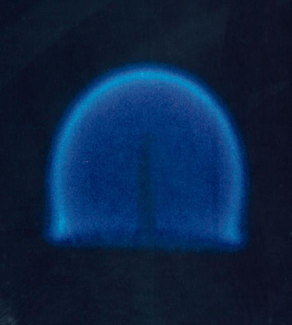
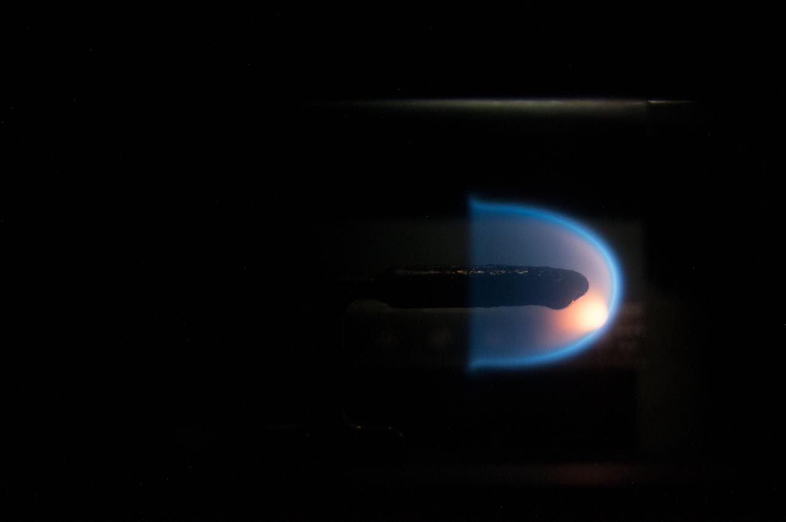
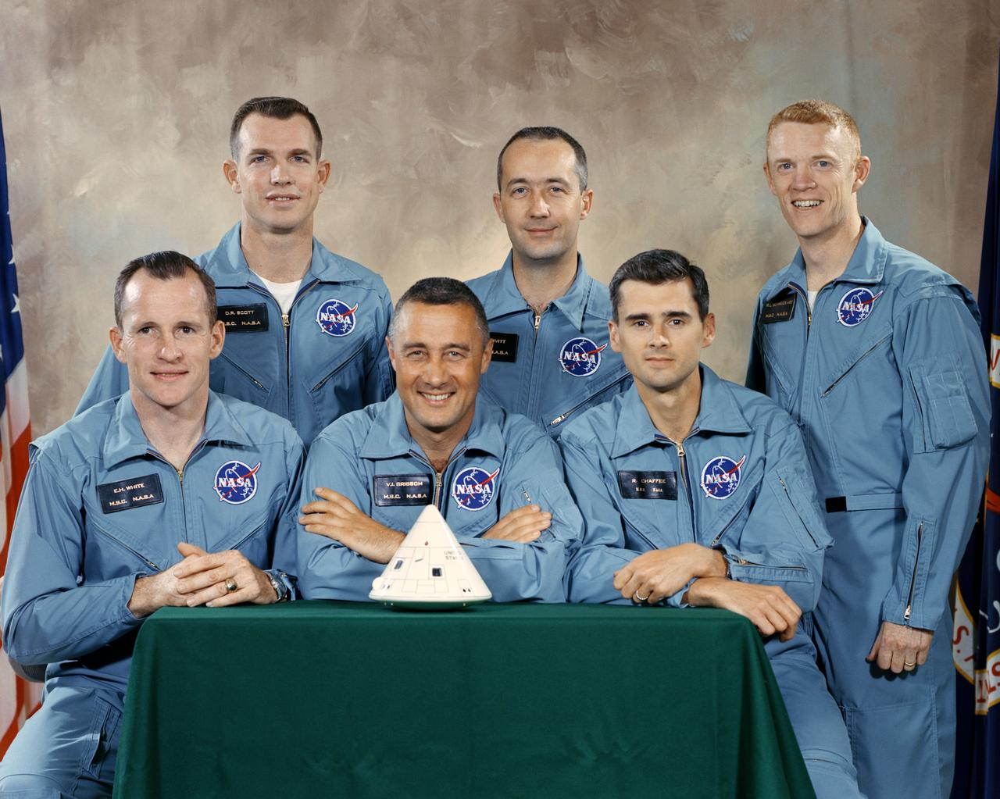
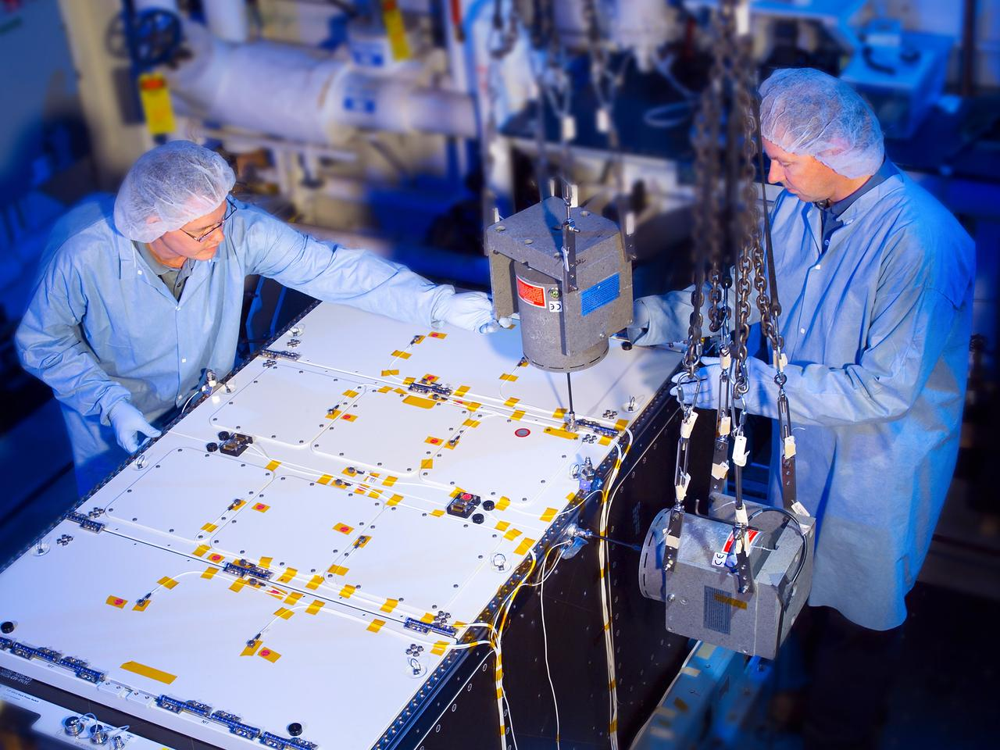
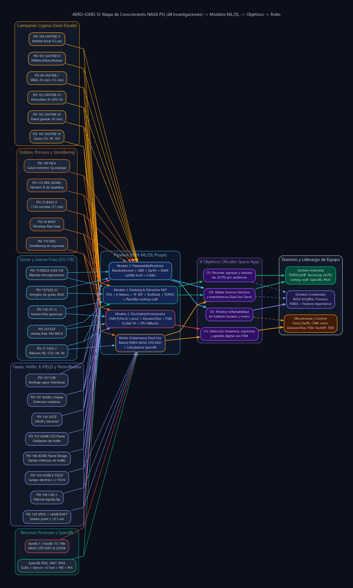
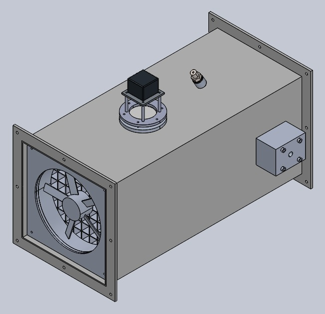
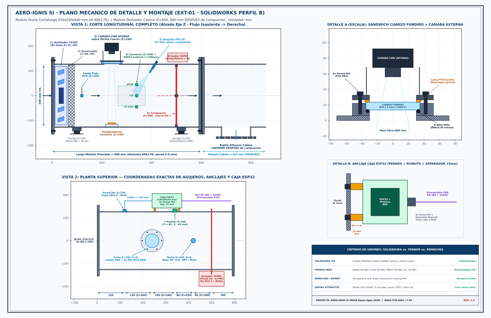
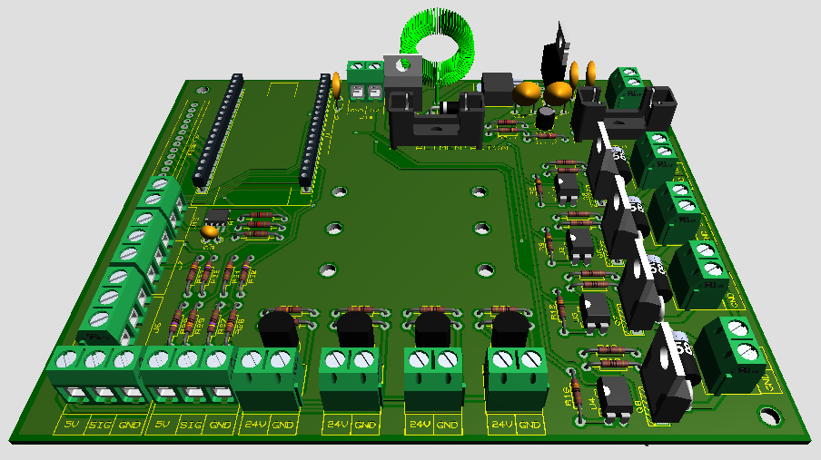
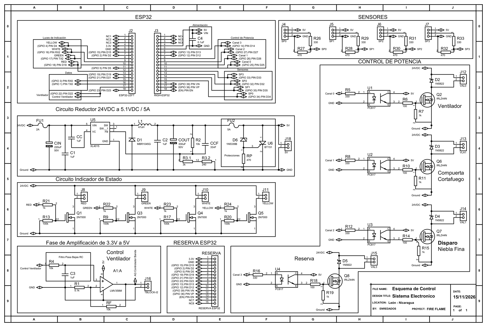
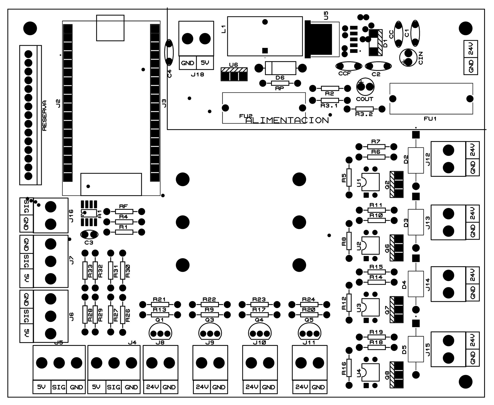

# AERO-IGNIS SI — Inteligencia Offline contra Incendios en Microgravedad (`NASA + ENREDADOS`)

> **Reto:** NASA Space Apps Challenge 2026 — *Flame in Freefall: SI-Powered Fire Safety Insights from Microgravity Combustion Data*  
> **Equipo:** **ENREDADOS** (León, Nicaragua) — Ingeniería Mecatrónica y de Control (`meca`) + Ingeniería de Gestión Industrial (`ind`)  
> **Alcance (`C-01`):** Exclusivamente módulos habitables presurizados (`ISS`, `Cygnus`, hábitats lunares $\ge 30\%\text{ O}_2$ y $\le 10.2\text{ psi}$) y transferencia terrestre Spinoff. Excluye motores cohete y vehículos lanzadores.  
> **Licencia y Costo (`C-02`):** Software **MIT** ([LICENSE](LICENSE)) · Datos científicos NASA PSI **CC0-1.0** · Ejecución **`$0 USD`** 100% local sin APIs ni LLMs externos de pago.

---

## En Órbita No Hay "Arriba": El Problema que Nos Movió a Construir Esto

En la Tierra, una chispa oculta detrás de un tablero calienta el aire a su alrededor y lo empuja hacia arriba. El humo llega al sensor del techo en segundos.

En caída libre (`0.00 g`), la flotabilidad desaparece. El aire caliente no sube: la llama adopta una geometría esférica, arde a menor temperatura con brillo azul tenue o invisible, y acumula gases tóxicos detrás de los paneles sin activar detectores convencionales de techo. Cuando un hábitat lunar tipo **Artemis** opera al **`34%` de $\text{O}_2$ y `8.2 psi`**, cada segundo sin aislar el ducto de ventilación compromete todo el volumen respirable de la tripulación.

<p align="center">
  
  &nbsp;&nbsp;
  
</p>
<p align="center">
  <em>Izquierda: llama esférica fría observada en ensayos de microgravedad de la NASA (sin penacho térmico ascendente). Derecha: llama estabilizada en flujo bajo durante el experimento orbital <strong>BASS-II</strong> en la ISS.</em>
</p>

---

## Quiénes Somos y Por Qué Nos Emociona Este Proyecto

Somos **ENREDADOS**, un equipo de dos ingenieros en **León, Nicaragua**: un **Ingeniero Mecatrónico y de Control** y un **Ingeniero de Gestión Industrial**.

Lo que nos entusiasma de **AERO-IGNIS SI** no es armar otra presentación teórica sobre seguridad espacial, sino **bajar la ciencia abierta de la NASA a ingeniería tangible que cualquier estudiante, laboratorio universitario o ingeniero de planta pueda entender, emular y fabricar con `$0 USD` de licencias**.

Para nosotros, unir los archivos abiertos de experimentos espaciales con componentes familiares —un microcontrolador `ESP32`, convertidores `XL4015`, optoacopladores `PC817`, aluminio `6061-T6`, modelos `ONNX` locales y análisis `FMEA/TOPSIS`— resuelve dos brechas a la vez:

1. **Trazabilidad entre disciplinas:** La física de microgravedad ($\text{Da}$, $\text{Pe}$, inflamabilidad límite) conversa directamente con la electrónica de potencia (`24 VDC`), la mecánica del ducto (`600 mm`) y la reducción cuantitativa de riesgo industrial (`NPR` de `1,901` a `134`, un **`-92.95%`**).
2. **Soberanía técnica sin la nube:** Una estación o un cuarto limpio en la Tierra no puede depender de una API remota cuando aparece aerosol submicrónico (`<0.1 μm`). Todo nuestro pipeline predictivo, de visión y de síntesis corre en CPU local, sin costos recurrentes y abierto bajo licencia MIT.

<p align="center">
  
  &nbsp;
  
  &nbsp;
  
</p>
<p align="center">
  <em>Contexto histórico y experimental integrado en el simulador: lección de atmósfera 100% $\text{O}_2$ en Apollo 1 (1967), incendio en la estación Mir (1997) e integración del Combustion Integrated Rack (CIR) en la ISS.</em>
</p>

---

## Qué Hace AERO-IGNIS SI (5 Módulos Integrados)

**AERO-IGNIS SI** indexa **24 investigaciones de combustión en microgravedad de NASA PSI** (DOIs `10.60555/...`), **566 corridas experimentales/calibradas de `BASS-II` y `Saffire I–VI`** y los **10 recursos oficiales del reto** dentro de cinco vistas conectadas:

| Módulo | Función Central | Tecnología Offline (`$0 USD`) |
| :--- | :--- | :--- |
| **`01 · Museo y Glosario`** | Exhibición curada con 6 fotografías NASA reales y glosario físico de referencia rápida | HTML/CSS editorial · `Geist Pixel` · modo offline |
| **`02 · Explorador PSI y TOPSIS`** | Búsqueda sobre las 24 PSI (`CC0-1.0`), clustering temático y ranking multicriterio por perfil | `TF-IDF + PCA + K-Means` + `TOPSIS/AHP` + `TextRank` (`writing-craft`) |
| **`03 · Simulador Forense e Inflamabilidad`** | Contorno adimensional $\text{Da}/\text{Pe}$, velocidad de llama $V_f$ y presets **Apollo 1**, **Apollo 13**, **Mir** y **Artemis** | `RandomForestClassifier` + `GradientBoostingRegressor` verificados por `SHA-256` |
| **`04 · Gemelo Digital + Hardware Abierto`** | Detección óptica y de gases acoplada al ducto liso de `600 mm` + planos descargables (`.STEP`, `.STL`, `.SVG`, `.PDF`) | CNN PyTorch (`64×64` → `flame_cnn.onnx`) + `DecisionTreeClassifier` + `FSM` |
| **`05 · Gobernanza FMEA y Dual-Use`** | Matriz `NASA-STD-6001` (`FM-01..FM-06`), árbol de supresión y retorno terrestre `Spinoff` | Reglas deterministas ECLSS + calculadora cuantitativa (`9582`, `9407`, `9918`, `PFE`) |

<p align="center">
  
</p>

---

## Prototipo Mecánico y Electrónico Abierto (Reproducible y Descargable)

Creemos que la seguridad crítica debe poder auditarse cable por cable y brida por brida. Desde la plataforma web se pueden inspeccionar en visor 3D interactivo, recorrer en carrusel y descargar los planos mecánicos y electrónicos del prototipo:

- **Ducto Instrumentado Liso (`SolidWorks` · Aluminio `6061-T6`, `250 × 250 × 600 mm`):** Diseñado sin derivaciones en T para conservar flujo laminar tras el ventilador axial y el enderezador hexagonal de `25 mm`. Integra mirilla superior de cuarzo (`Ø 60 mm`) para visión `64×64`, sondas de termopar rápido, $\text{CO}$ y aerosol `<0.1 μm`, boquilla atomizadora `PFE` a `30°` y actuador eléctrico externo *spring-return* (`24 VDC`) acoplado directamente sobre el eje de la compuerta mariposa (`0° → 90°`).
- **Tarjeta Electrónica de Control Abierta (`ESP32 + 24 VDC`):** Construida con componentes estándar fáciles de conseguir: regulador reductor `XL4015` (`24 VDC → 5.1 VDC / 5A`), etapa de aislamiento óptico `PC817` + MOSFET `IRLZ44N` para ventilador, compuerta y solenoide de neblina fina, amplificación `LMV358M` (`3.3 V → 5 V`) y señalización visual mediante `2N7000`. Incluye emulador lógico interactivo en la web para probar fallas y estados en tiempo real sin necesidad de tener la placa física conectada.

<p align="center">
  
  &nbsp;&nbsp;
  
</p>

<p align="center">
  
  &nbsp;&nbsp;
  
</p>

<p align="center">
  
</p>

---

## Impacto *Dual-Use* en la Tierra (Spinoffs Verificados)

La ingeniería diseñada para sobrevivir en un módulo presurizado regresa directamente a brigadas de bomberos, hospitales, túneles y cuartos limpios industriales:

| ID Spinoff | Año | Tecnología Aeroespacial Transferida | Ahorro de Masa / Capacidad | Reducción de Riesgo | Experimento PSI Vinculado |
| :---: | :---: | :--- | :---: | :---: | :--- |
| **`9582`** | `1976` | **Fireman's Air Tanks (`COPV / PLSS`):** Tanques compuestos de `2,216` a `4,500 psi` (`SCBA` de `33 lb` a `20 lb`) | **`13.0 lb/unidad`** (`-40%`) | **`-40.0%`** | `PSI-104` `SAFFIRE-V` (`10.60555/psi-104`) |
| **`9407`** | `1978` | **Incipient Fire Detector (`SAME` / Shuttle):** Discriminación temprana de aerosoles `<0.1 μm` por pirólisis | `0.0 lb` *(detección temprana)* | **`-58.0%`** | `PSI-129` `SPICE` (`10.60555/psi-129`) |
| **`9918`** | `1977` | **Project `FIRES` (`PBI + Nomex`):** Trajes estructurales ignífugos tras `Apollo 1` sin gases tóxicos | **`11.5 lb/unidad`** (`>30%`) | **`-35.0%`** | `PSI-101` `SAFFIRE-II` (`10.60555/psi-101`) |
| **`PFE`** | `2010` | **ISS Portable Fire Extinguisher (`Fine Water Mist`):** Niebla Sauter `20–100 μm`, expansión `1,700x`, sin `Halon` ni $\text{CO}_2$ | **`4.2 lb/unidad`** | **`-65.0%`** | `PSI-107` `CVB` (`10.60555/psi-107`) |

---

## Arranque Rápido y Seguridad OWASP / STRIDE (`$0 USD`)

```bash
# 1. Instalar dependencias de desarrollo y ejecución (Python 3.12+)
pip install -r requirements/dev.txt

# 2. (Opcional) Reentrenar modelos locales y regenerar manifiesto SHA-256
py -m backend.train_models

# 3. Ejecutar la plataforma web completa (API FastAPI + Dashboard en http://127.0.0.1:8000/)
cd backend && py main.py

# 4. Ejecutar pirámide completa de pruebas unitarias e integración TDD
py -m pytest -v
```

> Para entornos de solo producción sin suite de pruebas, usar `pip install -r requirements/base.txt`.  
> **Endurecimiento de seguridad integrado:** verificación `SHA-256` contra `artifacts/models/manifest.sha256.json` antes de cargar cualquier `.joblib` u `.onnx` (cero `.pkl`), DTOs Pydantic con `extra="forbid"`, tope de payload de `16 KB` (`HTTP 413`), *rate limiting* por IP (`HTTP 429`) y conector `OSDR` limitado a dominios oficiales NASA (`allow_redirects=False`, timeout `3.0 s`) con respaldo offline completo.

---

## Citas a los 10 Recursos Oficiales NASA

| # | Categoría | Recurso Oficial NASA | Enlace Directo |
| :-: | :--- | :--- | :--- |
| 1 | `Dataset Principal` | NASA PSI Combustion Repository | https://psi.nasa.gov/physci/repo/search?q=combustion |
| 2 | `Ciencia Base` | NASA Glenn Combustion Science | https://www.nasa.gov/glenn/glenn-expertise-space-exploration/physical-sciences-program/combustion-science/ |
| 3 | `Video Intro` | NASA ScienceCasts: ISS Combustion | https://www.youtube.com/watch?v=W1oXykoz9zg |
| 4 | `Guía 50+ Págs` | A Researcher's Guide to ISS Combustion Science | https://www.nasa.gov/missions/station/a-researchers-guide-to-combustion-science/ |
| 5 | `Forense 1967` | Apollo 1 Historical Case Study | https://sma.nasa.gov/sma-disciplines/accllp/apollo-1 |
| 6 | `Forense 1970` | Apollo 13 Historical Case Study | https://sma.nasa.gov/sma-disciplines/accllp/apollo-13 |
| 7 | `Forense 1997` | Fire Aboard Space Station Mir | https://www.nasa.gov/history/25-years-ago-fire-aboard-space-station-mir/ |
| 8 | `Spinoff 9582` | Fireman's Air Tanks (COPV) | https://spinoff.nasa.gov/node/9582 |
| 9 | `Spinoff 9407` | Incipient Fire Detector (Space Shuttle) | https://spinoff.nasa.gov/node/9407 |
| 10 | `Spinoff 9918 + PFE` | Fire Attire PBI & Fine Water Mist | https://spinoff.nasa.gov/node/9918 |

---

## Estructura del Repositorio y Guías Técnicas

```text
NASA/
├── README.md                                  # Narrativa de equipo, evidencia visual y arranque rápido
├── AGENTS.md                                  # Reglas operativas multi-perfil, OWASP, TDD y Git
├── SPEC.md                                    # Especificación SDD v1.1.0 (contratos REST + POO)
├── LICENSE                                    # Licencia MIT del software
├── requirements/                              # Dependencias separadas (base.txt / dev.txt)
├── backend/                                   # FastAPI, physics_ml.py, duct_twin.py, ranking_nlp.py, governance.py
│   └── main.py                                # Punto de entrada directo (`cd backend && py main.py`)
├── frontend/                                  # Dashboard Observatorio Claro + Museo + Visor STEP + Gemelo de Ducto
│   └── assets/                                # Fotografías NASA, plano SolidWorks, PCB 3D (.STEP/.STL/.PNG) y esquemáticos
├── data/                                      # psi_combustion_24.json, bass_saffire_runs.csv, cases_and_spinoffs.json
├── artifacts/models/                          # Pesos .joblib, flame_cnn.onnx y manifest.sha256.json
├── notebooks/AERO_IGNIS_Colab_Training.ipynb  # Pipeline reproducible en GPU T4 / CPU
├── planning/index.html                        # Tablero War Room interactivo de progreso
├── tasks/todo.md                              # Backlog auditable y bloqueos de archivos
├── docs/                                      # Conocimiento Obsidian (docs/knowledge/), grafos SVG/PNG e ingeniería industrial
└── tests/                                     # Pirámide TDD (tests/unit/ y tests/integration/)
```

- **Arquitectura y Contratos:** [SPEC.md](SPEC.md) · [AGENTS.md](AGENTS.md) · [tasks/todo.md](tasks/todo.md) · [planning/index.html](planning/index.html) · [backend/main.py](backend/main.py)
- **Visualizaciones Graphviz:** [Mapa 24 PSI → ML/DL](docs/graphs/psi_knowledge_graph.svg) · [Pipeline Colab + SHA-256](docs/graphs/ml_dl_colab_pipeline.svg) · [Arquitectura TDD/SDD](docs/graphs/tdd_sdd_architecture.svg)
- **Licenciamiento:** Código fuente bajo **MIT** ([LICENSE](LICENSE)); investigaciones y tablas científicas NASA PSI bajo **CC0-1.0**.
