# SPEC: AERO-IGNIS SI — Plataforma Web ML/DL Propia de Seguridad contra Incendios en Microgravedad

> **Versión de Especificación:** `1.0.0` (SDD Phase 1 — Pendiente de Aprobación Humana antes de Codificar)  
> **Reto:** NASA Space Apps Challenge 2026 — *Flame in Freefall: SI-Powered Fire Safety Insights from Microgravity Combustion Data*  
> **Paradigma:** Programación Orientada a Objetos (POO) + Pipeline 100% ML/DL Propio + Blindaje de Seguridad OWASP  
> **Disciplina Git:** `<version> - <verbo> - <descripción>` (`topic branch` $\rightarrow$ `dev` $\rightarrow$ `main`)

---

## SUPUESTOS DECLARADOS (SDD Gate)
1. **Cero API Keys de LLMs Externos:** Todo el razonamiento SI se ejecuta mediante **3 modelos ML/DL propios, deterministas y auditables** (`scikit-learn`, `PyTorch -> ONNX Runtime`, y `PCA/K-Means + TF-IDF/TextRank/TOPSIS`). No existen credenciales secretas ni riesgo de fuga de API keys de pago.
2. **Backend en Python POO (FastAPI + Pydantic v2) + Frontend Web Auto-Contenida (HTML5/JS/CSS + SVG Isométrico `anatomy`):** Ejecutable localmente o desplegable en la nube sin dependencias de pago (*Zero-Cost Directive*).
3. **Resiliencia Offline:** Los pesos exportados (`.joblib` / `.onnx`) y `data/psi_combustion_24.json` residen en el repositorio; la consulta en vivo a NASA OSDR v2 es opcional y con *timeout* estricto.
4. **Alcance Estricto NASA:** Solo entornos habitables de tripulación (ISS, Cygnus, hábitats lunares $\ge 30\%\text{ O}_2$, rovers) y Spinoffs terrestres (`Nodes 9582, 9407, 9918` + `PFE`). Motores de cohete y propulsores quedan excluidos.

> *Revisa esta especificación y confirma su aprobación antes de iniciar la implementación de la Tarea 1 (`M-02` / `I-01`).*

---

## FASE 0: Mapa de Capacidades (`Capability Map: aero-ignis-si`)

Las fronteras modulares son unidireccionales (sin dependencias circulares). Los contratos viven en los módulos proveedores.

| ID de Módulo | Responsabilidad Principal | Depende de |
| :--- | :--- | :--- |
| **`psi-domain-repo`** | Entidades inmutables POO y repositorio tipado de las 24 investigaciones PSI, esquemas `BASS-II`/`Saffire` y los 10 recursos oficiales. | `—` |
| **`security-guard`** | Validación de entradas en frontera (Pydantic), limitador de tasa anti-DDoS, cabeceras HTTP seguras, anti-SSRF y verificador SHA-256 de modelos ML/DL. | `—` |
| **`ml-ranking-nlp`** | Motor multicriterio `TOPSIS/AHP`, agrupamiento `PCA + K-Means`, resumen extractivo `TF-IDF + TextRank + Coseno` y plantillas dinámicas por audiencia. | `psi-domain-repo`, `security-guard` |
| **`flammability-rf-physics`** | Calculadora física adimensional ($\text{Da}, \text{Pe}, V_f$), `RandomForestClassifier` (`Extinguished`) + `GradientBoostingRegressor` (`Burn Time`, $V_f$) + `Feature Importance`. | `psi-domain-repo`, `security-guard` |
| **`duct-cnn-fsm`** | Clasificador visual `CNN (.onnx)` + `DecisionTreeClassifier` de sensores ($\Delta T/\Delta t$, $\text{CO}$, $<0.1\,\mu\text{m}$, flujo) + `FsmController` determinista con histéresis. | `security-guard` |
| **`fmea-spinoff-governance`** | Matriz de riesgo `FMEA/AMFE` (`NASA-STD-6001`), selector de supresión (`PFE`, $\text{CO}_2$, `E-FIELD`) y calculadora `Dual-Use` de Spinoffs. | `psi-domain-repo`, `security-guard` |
| **`web-dashboard-ui`** | Interfaz web accesible WAI-ARIA, Gemelo Digital isométrico SVG (`anatomy`), gráficas en tiempo real y galería Blueprint (`SolidWorks/EPLAN/Proteus`). | Todos los módulos backend |

**Orden de Construcción (Build Order):**  
`security-guard` & `psi-domain-repo` $\rightarrow$ `ml-ranking-nlp` & `flammability-rf-physics` & `duct-cnn-fsm` & `fmea-spinoff-governance` $\rightarrow$ `web-dashboard-ui`

---

## FASE 1: Especificación Técnica Detallada

### 1. Objetivo y Alcance
Construir **AERO-IGNIS SI**, un dashboard web interactivo con inteligencia propia (sin dependencia de APIs LLM externas) capaz de:
1. **Resumir, agrupar y rankear** las **24 investigaciones de combustión de NASA PSI** mediante `TOPSIS/AHP + PCA/K-Means + TF-IDF/TextRank`.
2. **Predecir inflamabilidad y extinción** mediante física adimensional ($\text{Da}$, $\text{Pe}$) y modelos `RandomForest` / `GradientBoosting` entrenados con datos reales de `BASS-II (PSI-25)` y `Saffire I–VI`, incluyendo presets forenses de **Apollo 1, Apollo 13 y Mir**.
3. **Operar un Gemelo Digital de Seguridad en Ducto** gobernado por una `CNN (.onnx)` + `Árbol de Decisión` + `FSM Determinista` (`NORMAL → PRE_ALERTA → CONTENCION → FALLA_SEGURA`) con respaldo de ingeniería física (`SolidWorks/EPLAN/Proteus`).
4. **Evaluar Riesgos y Spinoffs Dual-Use** con matriz `FMEA` (`NASA-STD-6001`) y métricas de transferencia terrestre (`Spinoffs 9582, 9407, 9918, PFE`).

---

### 2. Arquitectura Orientada a Objetos (POO) y Pipeline 100% ML/DL Propio

Todo el sistema se diseña bajo principios **SOLID**, encapsulando estado mediante `@dataclass(frozen=True)` para objetos de valor (Value Objects) e inyección de dependencias por constructor (sin variables globales mutables ni lógica suelta).

```mermaid
classDiagram
    class SecurityBoundaryGuard {
        -int max_payload_bytes
        -dict~str, int~ rate_limits
        +validate_request_size(content_length: int) void
        +check_rate_limit(client_ip: str, bucket: str) void
        +sanitize_query(text: str, max_len: int) str
        +verify_model_sha256(model_path: Path, manifest: Path) str
    }

    class PsiInvestigation {
        <<frozen dataclass>>
        +str psi_id
        +str acronym
        +str facility
        +str doi
        +float o2_min
        +float o2_max
        +tuple~str~ materials
        +str objectives
    }

    class PsiRepository {
        -Path data_path
        -SecurityBoundaryGuard guard
        -dict~str, PsiInvestigation~ _index
        +list_investigations(facility: str, query: str, page: int, size: int) PaginatedResult
        +get_by_id(psi_id: str) PsiInvestigation
        +fetch_osdr_metadata_safe(accession: str) dict
    }

    class TopsisMultiCriteriaRanker {
        -list~str~ criteria_names
        +rank(investigations: list~PsiInvestigation~, weights: dict) list~RankedInvestigation~
    }

    class ExtractiveNlpEngine {
        -TfidfVectorizer vectorizer
        -KMeans cluster_model
        +fit_or_load(manifest_path: Path) void
        +summarize_for_persona(items: list~PsiInvestigation~, query: str, persona: str) SynthesisReport
    }

    class FlammabilityPredictor {
        -RandomForestClassifier rf_extinguish
        -GradientBoostingRegressor gbr_burntime
        -SecurityBoundaryGuard guard
        +compute_dimensionless(state: AtmosphericState) PhysicsMetrics
        +predict(state: AtmosphericState) FlammabilityPrediction
    }

    class OnnxFlameVisionModel {
        -ort.InferenceSession session
        +classify_frame(features_or_preset: ndarray) VisionPrediction
    }

    class DeterministicFsmController {
        -FsmState current_state
        -int hysteresis_ticks
        +evaluate(vision: VisionPrediction, telemetry: SensorTelemetryFrame) FsmTransitionResult
    }

    class DuctSafetyOrchestrator {
        -OnnxFlameVisionModel vision_model
        -DecisionTreeClassifier sensor_tree
        -DeterministicFsmController fsm
        +step(telemetry: SensorTelemetryFrame, optical_input: OpticalInput) DuctTwinSnapshot
    }

    class GovernanceAndSpinoffService {
        -list~FmeaFailureMode~ fmea_items
        +evaluate_fmea(mitigated: bool) FmeaReport
        +calculate_dual_use(spinoff_id: str, units: int) DualUseImpact
    }

    PsiRepository --> PsiInvestigation
    PsiRepository --> SecurityBoundaryGuard
    TopsisMultiCriteriaRanker --> PsiInvestigation
    ExtractiveNlpEngine --> SecurityBoundaryGuard
    FlammabilityPredictor --> SecurityBoundaryGuard
    DuctSafetyOrchestrator *-- OnnxFlameVisionModel
    DuctSafetyOrchestrator *-- DeterministicFsmController
    GovernanceAndSpinoffService --> PsiRepository
```



#### Detalle de los 3 Modelos ML/DL Propios
1. **Objetivo 2 — `FlammabilityPredictor` (`RandomForestClassifier` + `GradientBoostingRegressor`):**
   - **Entrenamiento:** Tablas reales y curvas calibradas de `BASS-II (PSI-25)` (17 columnas, $>130$ corridas) y `Saffire I–VI` (`Percent O2`, `Pressure atm`, `Air Flow cm/s`, `Sample Thickness cm`, `Material`, `Flow Direction`).
   - **Salidas:** Probabilidad de auto-extinción (`Extinguished: Yes/No`), predicción de `Burn Time (s)`, tasa de propagación $V_f$ ($\text{mm/s}$), números adimensionales $\text{Da}/\text{Pe}$ e **Importancia de Variables (`feature_importances_`)** auditable.
2. **Objetivo 3 — `DuctSafetyOrchestrator` (`CNN PyTorch -> ONNX` + `DecisionTreeClassifier` + `FsmController`):**
   - **Rama Óptica:** CNN compacta entrenada sobre firmas visuales representativas de `BASS-II`, `FLEX` y `Saffire` exportada a `artifacts/models/flame_cnn.onnx` (4 clases: `0: Nominal`, `1: Llama Esférica Azul 0g`, `2: Llama Fría NTC`, `3: Propagación Abierta`).
   - **Rama Tabular:** `DecisionTreeClassifier` entrenado con umbrales físicos ($\Delta T/\Delta t$, $\text{CO ppm}$, aerosol $<0.1\,\mu\text{m}$, velocidad de flujo) que expone la regla exacta activada (*path trace*).
   - **Orquestador:** `DeterministicFsmController` (`NORMAL → PRE_ALERTA → CONTENCION → FALLA_SEGURA`) con contador de histéresis y simulación de enclavamiento cableado EPLAN.
3. **Objetivos 1 y 4 — `TopsisMultiCriteriaRanker` + `ExtractiveNlpEngine` (`PCA + K-Means + TF-IDF + TextRank`):**
   - **Agrupamiento:** `PCA (2 componentes)` + `K-Means` sobre vectores TF-IDF de los metadatos ISA-Tab (`Objectives`, `Approach`, `Earth Benefits`, sensores) de las 24 PSI.
   - **Ranking y Síntesis Determinista:** Combinación de puntuación `TOPSIS` con similitud coseno y extracción `TextRank`, formateada mediante plantillas dinámicas auditables para **Investigador**, **Estudiante** y **Gestor Industrial** (cero texto inventado).

---

### 3. Contratos de Interfaz (REST API & DTOs Pydantic v2)

Todos los endpoints validan estrictamente en frontera mediante esquemas Pydantic con `extra="forbid"` (rechaza campos no declarados con HTTP `422`). Formato único de error:
```json
{
  "error": {
    "code": "VALIDATION_ERROR | RATE_LIMITED | PAYLOAD_TOO_LARGE | INTEGRITY_ERROR",
    "message": "Descripción segura sin trazas internas ni stack traces"
  }
}
```

| Método y Ruta | Contrato de Entrada (Validado) | Contrato de Salida (DTO) |
| :--- | :--- | :--- |
| `GET /api/v1/health` | Ninguno | `{ "status": "ok", "models_verified_sha256": true, "psi_count": 24 }` |
| `GET /api/v1/psi/investigations` | `facility?: enum`, `q?: str(max 120)`, `page: int(1..10)`, `pageSize: int(1..50)` | `{ "data": [PsiInvestigation], "pagination": {...} }` |
| `POST /api/v1/psi/rank-and-interpret` | `weights: {habitat, modeling, sensors, spinoff}`, `persona: enum`, `query?: str(max 120)` | `{ "ranked": [...], "clusters_2d": [...], "synthesis": { "bullets": [...], "cited_dois": [...] } }` |
| `POST /api/v1/sandbox/predict-flammability` | `o2_pct: float(10..100)`, `pressure_psi: float(1..30)`, `flow_cm_s: float(0..60)`, `gravity_g: enum(0,0.16,0.38,1.0)`, `material: enum`, `thickness_mm: float(0.1..50)`, `flow_dir: enum` | `{ "extinguished_prob": float, "burn_time_s": float, "flame_spread_mm_s": float, "damkohler": float, "peclet": float, "regime": str, "feature_importance": [...] }` |
| `POST /api/v1/twin/step-fsm` | `optical_preset?: enum`, `optical_vector?: float[64]`, `delta_t_dt: float(-5..100)`, `co_ppm: float(0..5000)`, `submicron_aerosol: float(0..100)`, `airflow_cm_s: float(0..60)`, `comm_ok: bool` | `{ "cnn_class": str, "cnn_probs": float[4], "tree_rule_path": str, "fsm_state": str, "fan_on": bool, "damper_closed": bool, "pfe_active": bool }` |
| `GET /api/v1/governance/fmea-and-spinoffs` | `mitigated: bool`, `spinoff_id?: enum(9582,9407,9918,PFE)`, `units: int(1..10000)` | `{ "fmea_rows": [...], "spinoff_metrics": {...} }` |

---

### 4. Especificación de Seguridad y Hardening (Modelo de Amenazas STRIDE)

| Vector de Ataque | Amenaza Concreta | Control Obligatorio Implementado en Código |
| :--- | :--- | :--- |
| **Filtración de API Keys / Secretos** | Subida accidental de credenciales al repo Git o exposición al frontend. | **Cero llaves de API externas requeridas.** `.gitignore` bloquea `.env*`, `*.key`, `*.pem`; inspección obligatoria pre-commit `git diff --staged -i -G'password|secret|api_key|token'`. |
| **Ataques DDoS / Agotamiento de Recursos (L7)** | Ráfagas de peticiones sobre inferencia ML (`ONNX` / `RandomForest`), JSON gigantes o paginación masiva. | `RateLimiter` por IP en ventana deslizante (`60 req/min` general, `20 req/min` en rutas ML); tope estricto `MAX_PAYLOAD_BYTES = 16384` (HTTP `413`); paginación máxima `pageSize <= 50`; límites de hilos en `scikit-learn` (`n_jobs=1`) y `onnxruntime` (`intra_op_num_threads=1`). |
| **Inyección (SQL / NoSQL / Command / XSS)** | Manipulación de campos `query`, nombres de materiales o rutas hacia base de datos, shell o DOM. | Sin SQL concatenado ni `eval()`/`exec()`/`shell=True`. Validación estricta por *allowlist* (`Enum` y rangos Pydantic). En frontend prohibido `innerHTML` con datos de usuario (solo `textContent` y escape explícito). |
| **Deserialización Insegura (RCE vía `.joblib` / `.pkl`)** | Reemplazo malicioso de pesos ML para ejecutar código arbitrario al cargar modelos. | **Verificación criptográfica `SHA-256` obligatoria:** `SecurityBoundaryGuard.verify_model_sha256()` valida cada `.joblib` y `.onnx` contra `artifacts/models/manifest.sha256.json` antes de cargarlo; archivos `.pkl`/`.pickle` están prohibidos en `.gitignore`. |
| **Path Traversal & SSRF** | Escaneo de archivos locales o redirección de peticiones OSDR hacia red interna (`169.254.169.254`). | Sin rutas enviadas por el usuario al sistema de archivos (`Path.resolve()` anclado al root permitido). Conector OSDR anclado por *allowlist* estricta a `https://osdr.nasa.gov` y `https://visualization.osdr.nasa.gov` con `allow_redirects=False` y timeout `3.0s`. |
| **Clickjacking / MIME Sniffing / CORS Abierto** | Embeber el dashboard o robar respuestas desde orígenes maliciosos. | Cabeceras en cada respuesta: `Content-Security-Policy`, `X-Frame-Options: DENY`, `X-Content-Type-Options: nosniff`, `Referrer-Policy: no-referrer`, y CORS explícito sin `*`. |

---

### 5. Límites de Escalabilidad y Comandos Estándar

- **Presupuestos de Latencia:** Carga inicial `LCP < 2.5s`; inferencia ML tabular/TOPSIS `< 50ms`; inferencia ONNX `< 25ms`; cero bloqueos de red en arranque.
- **Comandos de Verificación:**
  - `pytest -v` (pruebas unitarias POO, límites físicos, transiciones FSM y pruebas de abuso/seguridad: payload >16KB, rate limit 429, XSS/SQLi rechazados con 422, hash SHA-256 corrupto abortado).
  - `python -m uvicorn backend.main:app --host 127.0.0.1 --port 8000`
  - `git diff --staged -i -G'password|secret|api_key|token' --name-only`

---

### 6. Estructura de Directorios Objetivo

```text
NASA/
├── .gitignore
├── .env.example
├── SPEC.md
├── PLAN_MAESTRO_FLAME_IN_FREEFALL.md
├── planning/
│   └── index.html
├── tasks/
│   └── todo.md
├── data/
│   ├── psi_combustion_24.json
│   ├── bass_saffire_runs.csv
│   └── cases_and_spinoffs.json
├── artifacts/
│   └── models/
│       ├── manifest.sha256.json
│       ├── flammability_rf.joblib
│       ├── burntime_gbr.joblib
│       ├── flame_cnn.onnx
│       ├── sensor_tree.joblib
│       └── psi_tfidf_kmeans.joblib
├── backend/
│   ├── __init__.py
│   ├── security.py          # SecurityBoundaryGuard, RateLimiter, HeadersMiddleware
│   ├── domain.py            # Dataclasses inmutables & PsiRepository
│   ├── physics_ml.py        # DimensionlessPhysicsCalculator + FlammabilityPredictor
│   ├── ranking_nlp.py       # TopsisMultiCriteriaRanker + ExtractiveNlpEngine
│   ├── duct_twin.py         # OnnxFlameVisionModel + DeterministicFsmController
│   ├── governance.py        # GovernanceAndSpinoffService (FMEA + Dual-Use)
│   ├── train_models.py      # Script reproducible Build-Time + generador SHA-256
│   └── main.py              # FastAPI app ensamblando capas POO
├── frontend/
│   ├── index.html
│   ├── styles.css
│   └── app.js
└── tests/
    ├── test_security_hardening.py
    ├── test_physics_and_ml.py
    ├── test_ranking_nlp.py
    ├── test_duct_fsm.py
    └── test_api_contracts.py
```

---

### 7. Plan de Versionado Git (`<version> - <verbo> - <descripción>`)

- `0.1.0 - docs - inicializar plan maestro y tablero war room para flame in freefall` (`main`)
- `0.2.0 - docs - redactar spec sdd con arquitectura poo pipeline ml propio y seguridad owasp`
- `0.3.0 - add - estructurar dataset psi de 24 investigaciones y casos forenses con pruebas` (`Task 1`)
- `0.4.0 - feat - implementar capa security guard anti ddos anti inyeccion y sha256` (`Task 2`)
- `0.5.0 - feat - entrenar pipeline ml propio random forest cnn onnx y clustering tfidf` (`Task 3`)
- `0.6.0 - feat - implementar motor fisico adimensional predictor rf y orquestador fsm` (`Tasks 4-6`)
- `0.7.0 - feat - exponer api fastapi poo con contratos pydantic y gobernanza fmea` (`Tasks 7-8`)
- `0.8.0 - design - construir dashboard web accesible con gemelo digital svg anatomy` (`Tasks 9-10`)
- `1.0.0 - ship - auditoria ponytail pruebas e2e y despliegue produccion` (`Tasks 11-12` en `main` con tag `v1.0.0`)
